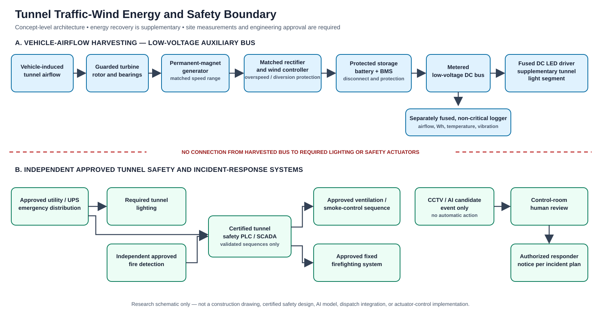

# Materials, Connections, and Circuit Block Diagram

## Scope

This is a **system block diagram for research and low-voltage concept discussion**, not a construction drawing. It does not specify tunnel mains wiring, fire-alarm wiring, motor starters, pump circuits, cable sizes, grounding details, battery ratings, protection coordination, structural supports, or approved equipment. Those items must be designed to site conditions and local codes by the responsible tunnel engineers.

## Energy-harvesting branch

Actual generator topology may differ. If the generator's output is not three-phase AC, the rectifier and controller must match that generator. A normal solar-only controller may not be suitable for a wind generator, especially when unloaded or at overspeed; select a controller and diversion arrangement for the actual turbine.

## Separate tunnel safety systems

The lower half of the SVG separates the approved tunnel systems. Camera or AI output remains a candidate for control-room review; responder contact and any fan or firefighting action follow the approved tunnel emergency plan and certified safety controls.

The dashed relationships indicate prohibited direct reliance/control in this demonstrator. In a real tunnel, only the approved electrical and control-system design can define any connection.

## Connection schedule for the energy branch

| From | To | Signal/power | Notes |
|---|---|---|---|
| Turbine rotor shaft | Generator | Mechanical rotation | Guard, overspeed limits, vibration and attachment design are site-specific. |
| Generator terminals | Rectifier or matched controller input | Variable electrical output | Confirm phase, voltage, frequency/speed range, current and open-circuit behavior. |
| Rectifier DC output | Wind charge controller | DC input | Confirm polarity and controller compatibility. |
| Controller output | Protected storage/BMS | Regulated charging | Battery chemistry, charge profile, temperature protection and fire enclosure require engineering selection. |
| Storage output | Main disconnect and DC bus | DC power | Add protection and metering sized for fault current and conductor length by a qualified designer. |
| DC bus | Fused LED driver branch | DC power | Keep this branch supplemental; required tunnel lighting stays on its approved system. |
| DC bus | Fused logger/sensor branch | DC power | Non-critical; graceful shutdown on low battery. |
| Airflow/voltage/current/temperature sensors | Data logger | Low-voltage data | Log synchronized measurements and calibration metadata. |

Do not join this bus to a tunnel's utility distribution, emergency lighting, UPS, fire alarm, fan controls, smoke dampers, fire pumps, deluge valves, or dispatch network based on this diagram.

## Materials categories

1. Guarded turbine module with rotor, bearings, shaft, and mounting concept chosen after tunnel airflow study.
2. Permanent-magnet generator with a documented speed/torque/output envelope.
3. Generator-matched rectifier and wind charge controller, including the required diversion/overspeed protection.
4. Battery and BMS selected for the specified chemistry, charge profile, location temperature, fault current, and enclosure/fire requirements.
5. DC disconnect, branch protection, surge protection, terminal blocks, connectors, conductor insulation, and enclosures selected to the actual installation classification and local code.
6. DC energy meter, voltage/current logging, airflow sensor/anemometer, temperature probes, accelerometer/vibration logger, and data logger.
7. DC driver and supplementary LED luminaire compatible with the chosen DC bus.
8. Separate camera/edge equipment and its approved independent supply. No camera model or alarm threshold is validated by this repository.

## Measurements to record

- Air speed and direction at multiple points, with sensor position and calibration.
- Generator speed and electrical output under a real load, not open-circuit voltage alone.
- Rectified/controller output and cumulative Wh delivered at the bus and LED branch.
- Battery state, charge/discharge losses, temperature, and low-voltage events.
- Tunnel ventilation mode, differential pressure, pollutant/visibility readings available to the operator, vehicle count/class/speed, and traffic conditions.
- Rotor vibration, noise, temperature, downtime, maintenance actions, and any safety stop.

## Illustrative electrical output

For the example in [RESEARCH.md](RESEARCH.md), one 0.25 m² swept-area turbine at an assumed 6 m/s gust produces 32.4 W of airflow kinetic power over the swept area. With assumed (C_p=0.25), generator efficiency 0.75, and converter efficiency 0.90, the simple model gives 5.47 W DC during the gust. That is a point estimate while the assumed gust lasts; it is not continuous output. Eight turbines with assumed 1,000 pulses/day of 10 seconds each yield 121.5 Wh/day gross before storage, wiring, standby, downtime, flow interaction, and vehicle energy effects.

For the assumed loads, supplementary light is 48 Wh/day, camera 120 Wh/day, and edge compute 192 Wh/day, or 360 Wh/day total. This demonstrates why site measurement and load prioritization are necessary. It does not establish that these loads can safely or reliably be powered from traffic airflow.
